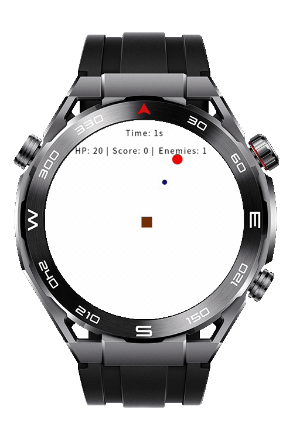
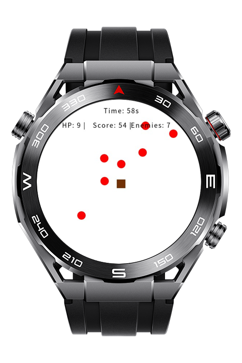
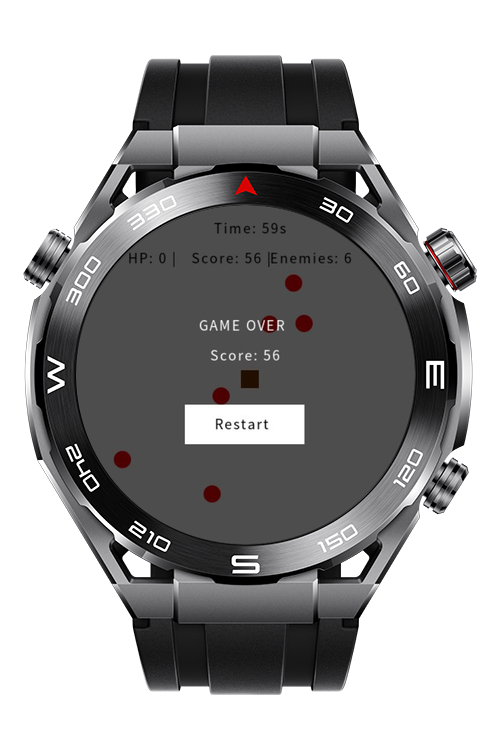

> **Note:** To access all shared projects, get information about environment setup, and view other guides, please visit [Explore-In-HMOS-Wearable Index](https://github.com/Explore-In-HMOS-Wearable/hmos-index).

# Tower Defense Game

This is a Canvas-based tower defense game developed using. Players defend a central tower from waves of incoming enemies, upgrade tower stats, and aim for the highest score possible. The game runs entirely on a canvas.
# Preview

<div>
  
  
  
</div>

# Use Cases

- **Tower Defense Gameplay:** Defend the central tower from waves of enemies spawning around it.
- **Level-Up System:** Upgrade tower attributes such as Attack Speed, Damage, or HP after reaching score milestones.
- **Dynamic Enemy Spawning:** Enemies spawn in increasing numbers and strength over time.
- **Projectile Mechanics:** Tower automatically targets and shoots the closest enemy.
- **Score & Time Tracking:** Keep track of score, time survived, and remaining tower HP.
- **Game Over & Restart:** Game ends when tower HP reaches zero; restart with a button click.

# Tech Stack
- **Languages**: ArkTS / HML
- **Frameworks**: HarmonyOS 6.0.0 Beta3
- **Tools**: DevEco Studio 6.0.0.828
- **Libraries**:
    - `CanvasRenderingContext2D`

# Directory Structure

```
entry/
├── src/main/
│ 
├── src/main/js/MainAbility
│ ├── pages/index
│ │ ├── index.css
│ │ ├── index.hml
│ │ └── index.js
```

# Constraints and Restrictions
## Supported Device

- Huawei Sport (Lite) Watch GT 4/5/6
- Huawei Sport (Lite) GT4/5 Pro
- Huawei Sport (Lite) Fit 3/4
- Huawei Sport (Lite) D2
- Huawei Sport (Lite) Ultimate

# License

**Tower Defense Game** is distributed under the terms of the MIT License

See the [LICENSE](./LICENSE) for more information.
